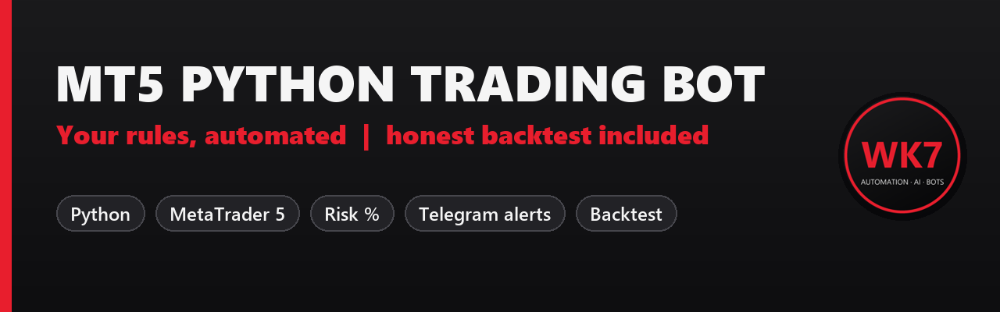

<p align="center"></p>

<p align="center">
  
  
  
</p>

# MT5 Python Trading Bot

A clean, readable **Python trading bot for MetaTrader 5** with the things a real bot needs:
risk-based position sizing, stop loss and take profit on every trade, a daily loss limit,
trading-hours filter, Telegram alerts and an **honest backtester** that includes spread and commission.

Swap the example strategy for your own rules: the rest of the framework keeps working.

## Features

| | |
|---|---|
| **Risk % sizing** | lots calculated from your balance, risk % and stop distance (never rounded up) |
| **SL / TP on every order** | ATR-based by default, easy to change |
| **Daily loss limit** | no new trades after -X% in a day |
| **Trading hours** | only opens trades in the hours you choose (UTC) |
| **One position per symbol** | positions are tagged with a magic number |
| **Telegram alerts** | start, signals, orders and errors on your phone |
| **Dry-run mode** | see what the bot would do before it sends real orders |
| **Backtest = live logic** | the backtest and the live bot call the same `signal_sides()` function |

## Quick start

```bash
git clone https://github.com/Wkk7/mt5-python-trading-bot.git
cd mt5-python-trading-bot
pip install -r requirements.txt
cp .env.example .env        # edit symbols, risk, Telegram
python backtest.py          # honest backtest on the sample data
python run_bot.py           # live loop (DRY_RUN=true by default)
```

Requirements: Windows, the MetaTrader 5 terminal installed and logged in, Python 3.10+.
**Always test on a demo account first.**

## Honest backtest

```bash
python backtest.py                         # data/EURUSD_H1.csv (2022-2025)
python backtest.py --mt5 GBPUSD --bars 30000 --risk 1
```

How it avoids fake results:
- signal on a **closed** candle, entry at the **next** candle's open
- spread and commission paid on every trade
- if stop loss and take profit are hit in the same candle, the **loss** is counted

<p align="center"></p>

The example strategy (EMA trend + RSI pullback) **loses money after costs** on EURUSD H1 2022-2025:
profit factor 0.89 over 178 trades. That is the point of an honest backtester. Most "profitable"
strategies you see online stop being profitable once real costs are included, and this tool shows
you that **before** you risk real money. Plug in your own rules and test them the same way.

## Project structure

```
bot/
  strategy.py   your trading rules (replace this)
  risk.py       lot size from risk %, daily loss guard
  broker.py     MetaTrader 5 wrapper: data, positions, orders
  notifier.py   Telegram alerts
  config.py     settings from .env
run_bot.py      live loop
backtest.py     backtest with costs, chart and trade list
tests/          unit tests (python -m unittest)
```

## Use your own strategy

Edit `signal_sides()` in `bot/strategy.py`: return `1` (buy), `-1` (sell) or `0` for each candle.
Stops and targets come from `StrategyParams` (`sl_atr`, `tp_atr`).

## Need a custom bot?

I build MT5 bots, Telegram signal tools and backtests to order, in Python or MQL5:
**[Hire me on Fiverr](https://www.fiverr.com/wassimkamill)**.

---

*This project is for education and research. Trading involves risk of loss; past results do not
guarantee future results. Nothing here is financial advice.*

MIT License
